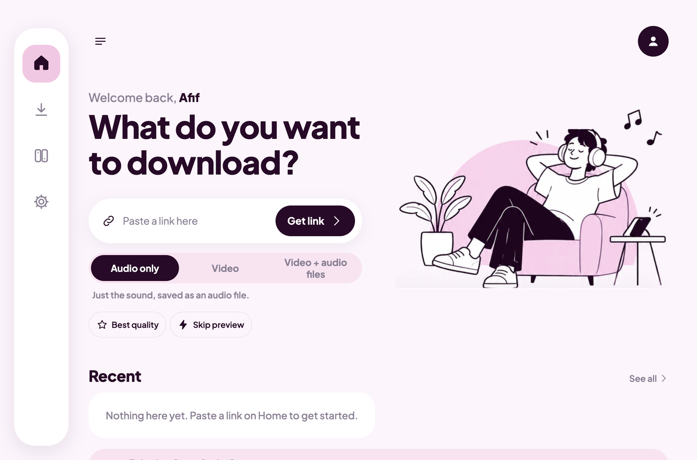
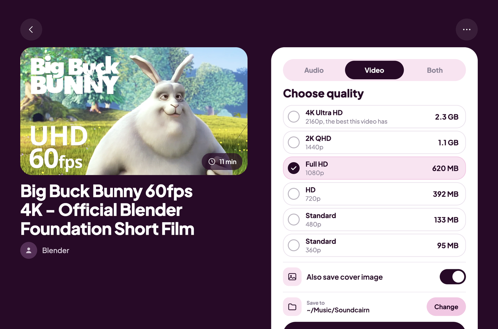
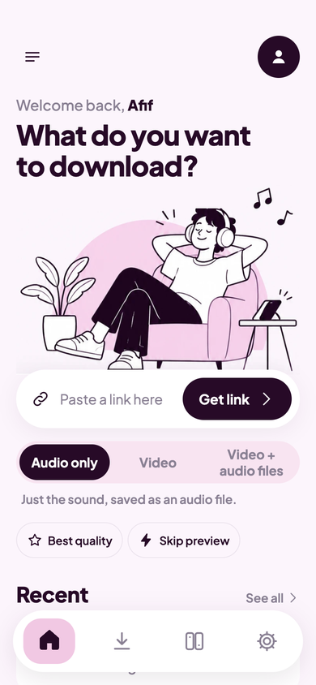

<div align="center">


# Soundcairn

**Paste a link. Pick audio, video or both. Keep it.**

A calm, friendly downloader for macOS, Windows and Android, built on [yt-dlp](https://github.com/yt-dlp/yt-dlp).

</div>

<p align="center">
  
</p>

## Download

Get the latest build from the [Releases page](https://github.com/enkidu0-0/soundcairn/releases/latest).

| Platform | File | First-time notes |
|---|---|---|
| macOS (Apple silicon) | `Soundcairn-<version>-arm64.dmg` | Install yt-dlp and ffmpeg once: `brew install yt-dlp ffmpeg`. The app is unsigned, so right-click it and choose Open the first time. |
| macOS (Intel) | `Soundcairn-<version>-x64.dmg` | Same as above. |
| Windows 10/11 | `Soundcairn-Setup-<version>.exe` | Windows SmartScreen may warn (unsigned): choose More info, then Run anyway. The app downloads yt-dlp and ffmpeg on first run. |
| Android 10+ (arm64) | `Soundcairn-<version>.apk` | Allow installs from your browser or file manager when asked. Nothing else to install. |

## Why Soundcairn

Most downloaders drown you in formats and codes. Soundcairn shows only what the link really offers, in plain words.

- **Audio, video, or both in one tap.** Choose *Audio only*, *Video*, or *Video + audio files* (a video and a separate audio file).
- **Real quality choices.** The list is built from the link itself: 8K, 4K, 2K, Full HD, HD and smaller for video, and the actual audio streams (codec and bitrate) for audio. If a video has no 4K, 4K is not offered. Each choice shows its real file size.
- **Best means best.** Audio is kept as the original stream, with no re-encoding. MP3 is there when you want it to play anywhere. Video is capped to what you pick.
- **Pick where it goes.** Choose the save folder right on the download screen.
- **Progress you can trust.** Live progress, speed, pause, resume and cancel, with several downloads at once.
- **A library and a player.** Everything you download appears in the Library and plays inside the app (speed, 10-second skip, sleep timer). The three-dots menu shows the file in Finder, File Explorer or Downloads.
- **No accounts, no ads, no analytics.** Your name stays on your device.

<p align="center">
  
</p>

## Get it running

To run it from source you need [Node.js](https://nodejs.org) 20 or newer, plus **yt-dlp**, **ffmpeg** and **ffprobe** (the app looks for them next to itself, in its tools folder, and on your PATH; on a Mac `brew install yt-dlp ffmpeg` is enough).

```bash
git clone https://github.com/enkidu0-0/soundcairn.git
cd soundcairn/desktop
npm install
npm start
```

Build an app or installer:

```bash
npm run dist:mac    # macOS dmg files in desktop/release
npm run dist:win    # Windows installer in desktop/release
```

On Windows, the installed app offers to download yt-dlp, ffmpeg and ffprobe the first time you open it.

### Android

A plain Android project (no Capacitor) in [`android/`](android). yt-dlp and ffmpeg run on the phone.

```bash
cd android
./build-www.sh
./gradlew assembleDebug     # needs JDK 17 and the Android SDK (platform 35)
```

The APK is written to `android/app/build/outputs/apk/debug/`. It needs Android 10 or newer on an arm64 phone.

<p align="center">
  
</p>

## How it works

```
 index.html (one page, phone and desktop layouts)
      |
      +-- desktop: Electron  -> main.js runs yt-dlp and ffmpeg
      +-- android: WebView   -> Kotlin Bridge runs yt-dlp and ffmpeg (youtubedl-android)
```

The page never downloads anything itself. It asks the native side to run yt-dlp, reads the progress lines back and draws them.
`desktop/lib.js` turns your choices into yt-dlp commands and parses its output, and is covered by tests (`npm test` in `desktop/`).

## Project status

Early release (v0.1.0). The macOS app is the one tested most. The Windows installer and the Android app are new, so expect rough edges,
and please [open an issue](https://github.com/enkidu0-0/soundcairn/issues) if something breaks.
Builds are unsigned for now, so macOS and Windows will warn you about an unknown developer.

## Support the project

Soundcairn is free and made by one person. If it helps you, there is a **Buy me a chai** screen in the app (UPI, from ₹8).
The payment details live in one protected file, `desktop/app/donate.js`.

## Please download responsibly

Only download content you have the right to save, such as your own uploads, public-domain and Creative Commons work, or things you
have permission for. Respect the terms of the sites you use. Soundcairn is a tool; you are responsible for how you use it.

## Credits

Soundcairn stands on the shoulders of:

- [yt-dlp](https://github.com/yt-dlp/yt-dlp) and [FFmpeg](https://ffmpeg.org), which do the real work
- [youtubedl-android](https://github.com/yausername/youtubedl-android) (GPL-3.0) for yt-dlp and ffmpeg on Android
- [Electron](https://www.electronjs.org), [qrcode-generator](https://github.com/kazuhikoarase/qrcode-generator) (MIT) and the [Plus Jakarta Sans](https://fonts.google.com/specimen/Plus+Jakarta+Sans) typeface

## License

MIT, see [LICENSE](LICENSE), for everything except [`android/`](android), which is GPL-3.0 because it uses youtubedl-android
(see [`android/LICENSE`](android/LICENSE)).

---

<p align="center">Made by <b>Afif aka Enkidu</b></p>
